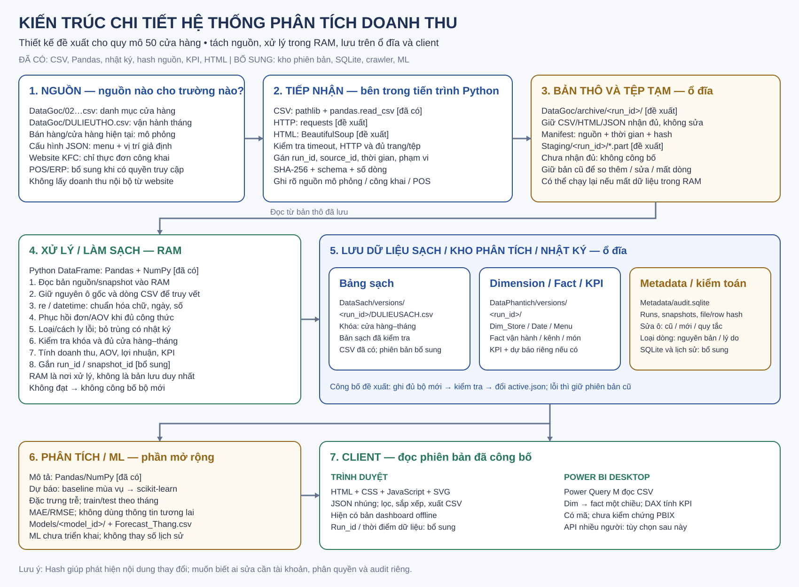
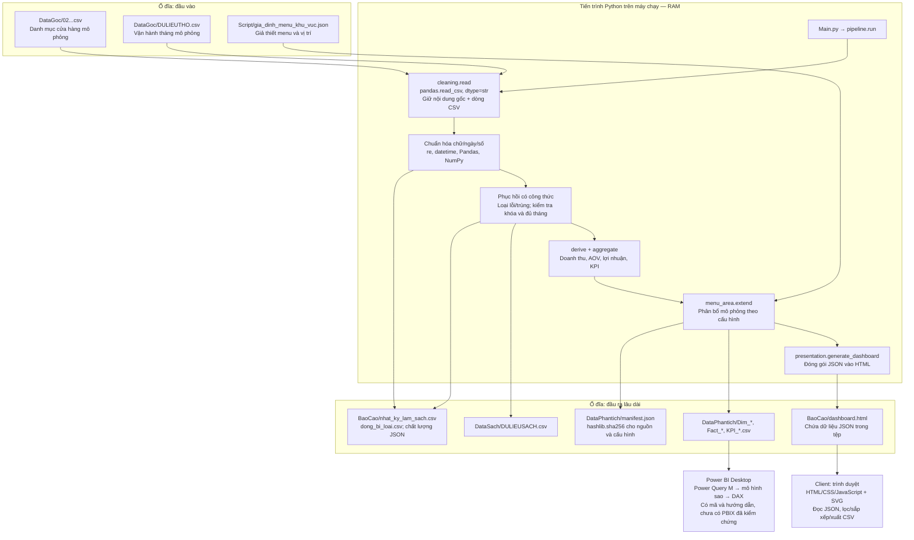

# Kiến trúc chi tiết và đề xuất công nghệ

Đối chiếu mã và tệp dự án ngày 13/10/2026. Phần **hiện có** mô tả việc đã được triển khai; phần **đề xuất** mô tả việc cần bổ sung. Đây là tài liệu thiết kế, không xác nhận crawler, cơ sở dữ liệu, API hay Machine Learning đã chạy.



## 1. Nhận xét về yêu cầu

Yêu cầu hợp lý vì một sơ đồ chỉ có Client → Server → Database chưa giải thích được hệ thống này. Cần mô tả cho từng bước: dữ liệu đầu vào, nguồn sở hữu, cách tiếp nhận, nơi lưu, thư viện xử lý, quy tắc kiểm tra, đầu ra và cách truy vết. Phân biệt sơ đồ kiến trúc, luồng xử lý và bảng công nghệ; thư viện là cách triển khai các khối chức năng.

Đề xuất bắt đầu bằng hệ thống xử lý theo lô trên một máy. Với 50 cửa hàng và 1.464 bản ghi vận hành tháng, Pandas + kho tệp có phiên bản + SQLite cho metadata là thiết kế vừa đủ. Chưa cần Redis, Kafka hoặc Hadoop. Có thể đặt tiến trình Python trên máy chủ nếu cần chạy định kỳ; việc gọi khối đó là server không có nghĩa dự án hiện đã có một API server.

## 2. Nguồn dữ liệu thực sự của dự án

| Nguồn | Nơi lấy và cách tạo | Trường chính | Phạm vi và giới hạn |
|---|---|---|---|
| `DataGoc/02_KFC_TPHCM_cua_hang_mo_phong.csv` | CSV người dùng cung cấp; bổ sung cửa hàng bằng `Script/expand_stores.py`, seed 20261007 | Mã nguồn SIM, thành phố, ngày mở, tham số đơn/AOV/chi phí cơ sở | 59 dòng thô → 50 cửa hàng; mô phỏng, không phải danh mục cửa hàng nội bộ KFC |
| `DataGoc/DULIEUTHO.csv` | CSV chuyển từ Excel người dùng cung cấp; phần mở rộng do bộ sinh trên tạo | Tháng, đơn/AOV ba kênh, tỷ lệ giá vốn/phí, chi phí và các cột dẫn xuất | 1.485 dòng thô → 1.464 cửa hàng–tháng; 2023–2025; không phải giao dịch POS thật |
| `Script/gia_dinh_menu_khu_vuc.json` | Cấu hình do người xây dựng hệ thống khai báo | 8 món, giá tham chiếu, trọng số nhóm món, khu vực/loại vị trí của cửa hàng | Menu và địa điểm giả định; doanh thu món là phân bổ, số lượng món là ước tính |
| `Datamoi/MENU_CONGKHAI_THO.csv` và bản sạch | Theo `Datamoi/README.md`: mẫu thực đơn đọc từ nội dung được lập chỉ mục của trang KFC chính thức, ngày 11/10/2026 | Tên món, nhóm, giá hiển thị, URL nguồn, ngày tra cứu | Chỉ 8 món, chưa chọn cửa hàng; không xác nhận giá thanh toán; chưa được Main.py đọc |
| POS/ERP hoặc xuất giao dịch doanh nghiệp | **Đề xuất khi có quyền truy cập:** doanh nghiệp xuất CSV hoặc cung cấp API | Mã đơn, món, số lượng, chiết khấu, doanh thu thuần, cửa hàng, thời gian, kênh | Nguồn cần có để phân tích món bán chạy thực tế; hiện chưa có kết nối này |

Nguồn công khai cho thực đơn: [Trang đặt hàng KFC Việt Nam](https://kfcvietnam.com.vn/order/delivery). Đây không phải nguồn số đơn, doanh thu, giá vốn hay lợi nhuận nội bộ.

**Hai bộ dữ liệu riêng:** dashboard hiện tại dùng mô hình 50 cửa hàng trong DataSach/DataPhantich. Datamoi chứa một bộ khác với 20 cửa hàng và 576 bản ghi sạch, kèm mẫu menu công khai. Không thay thế hoặc cộng gộp hai bộ này. Giá menu tra cứu năm 2026 không được gán cho doanh số 2023–2025 để gọi là doanh thu món lịch sử thật.

Kiểm tra ngày 13/10/2026: SHA-256 của cả hai tệp DataGoc hiện khớp `DataPhantich/manifest.json`. Kết quả này xác nhận khớp phiên bản đầu vào được ghi nhận, không xác nhận số liệu kinh doanh có thật hoặc mọi đầu ra chưa bị sửa.

## 3. Sơ đồ triển khai hiện có



Không có cơ sở dữ liệu hay API chạy thường trực trong luồng này. Nếu mở HTML bằng một HTTP server cục bộ, server đó chỉ phục vụ tệp; nó không đảm nhiệm thu thập, làm sạch hay tính KPI. Trang dashboard không tự nhận dữ liệu mới khi nguồn CSV thay đổi: cần chạy lại pipeline và tạo lại HTML.

## 4. Kiến trúc đề xuất với các khối bên trong

```mermaid
flowchart TB
    subgraph SRC["1. Nguồn độc lập"]
        CSV["CSV nguồn mô phỏng hiện có"]
        POS["Xuất POS/ERP hoặc API được cấp quyền — bổ sung"]
        WEB["Website KFC: thực đơn công khai — bổ sung crawler"]
    end
    subgraph BACK["2. Máy chạy xử lý / server: tiến trình Python"]
        GET["Bộ tiếp nhận<br/>pathlib cho tệp; requests cho HTTP<br/>BeautifulSoup nếu có HTML cần phân tích"]
        IN["Gán run_id; kiểm tra đủ tệp/trang<br/>Nguồn, thời gian, phạm vi, hash, schema"]
        RAM["Pandas DataFrame trong RAM<br/>dtype/schema rõ; không dùng làm bản lưu duy nhất"]
        CLEAN["Chuẩn hóa → phục hồi có căn cứ → kiểm tra<br/>Khóa trùng, thiếu, âm, quan hệ và độ phủ"]
        PASS{ "Đạt kiểm tra?" }
        BUILD["Tạo DULIEUSACH, dimension/fact, KPI<br/>Tính lại tỷ lệ từ các tổng"]
        COMMIT["Ghi bộ đầu ra theo run_id<br/>Kiểm tra số dòng/hash → công bố active.json"]
        GET --> IN
        RAM --> CLEAN --> PASS
        PASS -->|Có| BUILD --> COMMIT
    end
    subgraph STORAGE["3. Lưu trữ trên ổ đĩa — phân vùng theo chức năng"]
        RAW["DataGoc/archive/run_id<br/>Ảnh chụp thô CSV/JSON/HTML + manifest<br/>Không ghi đè lần trước"]
        TMP["Staging/run_id<br/>Tệp tạm .part và kết quả chưa công bố"]
        ERR["Quarantine/run_id<br/>Dòng bị loại + nguyên bản + lý do"]
        CUR["DataSach/versions/run_id<br/>Dữ liệu sạch đã kiểm tra"]
        MART["DataPhantich/versions/run_id<br/>Dimension/fact, KPI, forecast nếu có"]
        AUDIT["Metadata/audit.sqlite<br/>Lượt chạy, hash tệp/dòng, thay đổi, trạng thái"]
        GET --> TMP
        IN --> RAW
        RAW --> RAM
        PASS -->|Không| ERR
        IN --> AUDIT
        CLEAN --> AUDIT
        COMMIT --> CUR
        COMMIT --> MART
        COMMIT --> AUDIT
    end
    subgraph ANALYSIS["4. Phân tích"]
        DESC["Phân tích mô tả — Pandas/NumPy"]
        ML["Dự báo tùy chọn — scikit-learn<br/>Đặc trưng trễ; chia theo tháng; MAE<br/>So với dự báo mùa vụ đơn giản"]
        CUR --> DESC
        CUR --> ML
        DESC --> MART
        ML --> MART
    end
    subgraph CLIENT["5. Công bố và sử dụng"]
        PAGE["Trình duyệt: HTML/CSS/JS/SVG<br/>KPI, biểu đồ, lọc, CSV; hiển thị run_id"]
        POWER["Power BI: Power Query M, DAX<br/>Đọc bộ phiên bản đã công bố"]
        MART --> PAGE
        MART --> POWER
    end
```

Kho phiên bản, Staging, Quarantine, SQLite, con trỏ công bố, crawler và ML trong sơ đồ đề xuất **chưa được triển khai trong dự án hiện tại**. Dòng bị loại và nhật ký hiện đã có, nhưng đang được ghi thành tệp ở BaoCao thay vì kho theo từng run_id.

## 5. Nhận dữ liệu bằng công nghệ gì?

| Tình huống | Công nghệ | Cách xử lý và bằng chứng cần lưu |
|---|---|---|
| Nhận CSV hiện có | `pathlib`, `pandas.read_csv` | Kiểm tra tệp tồn tại, encoding, header; lưu tên tệp, SHA-256, kích thước, thời điểm nhận, kỳ dữ liệu và số dòng |
| Nhận Excel mới | `pandas.read_excel` + `openpyxl` | Ghi tên workbook/sheet, dòng nguồn; giữ workbook gốc, rồi chuẩn hóa bảng nhập; pipeline hiện tại chỉ đọc CSV |
| API doanh nghiệp được cấp quyền | `requests` | Kiểm tra mã HTTP, timeout, phân trang, số trang/đơn dự kiến; lưu phản hồi gốc; chỉ đánh dấu nhập đầy đủ khi mọi trang đạt |
| Thực đơn trong HTML tĩnh | `requests` + `beautifulsoup4` | requests nhận nội dung; BeautifulSoup phân tích HTML theo selector; lưu URL, thời điểm, chi nhánh nếu có, nội dung gốc và phiên bản bộ trích xuất |
| Trang chỉ dựng dữ liệu bằng JavaScript | API/JSON công khai hợp lệ nếu có; nếu cần thì công cụ trình duyệt | Không kết luận requests đã lấy đủ menu chỉ vì HTTP 200; cần kiểm tra nội dung và số bản ghi. Đây là nhánh cần khảo sát trước khi chọn công nghệ |

CSV cục bộ không cần crawl. Không ghi `requests` hoặc BeautifulSoup là công nghệ đã dùng để nhận doanh thu nếu không có bộ thu thập đó trong mã. Nguồn từ công cụ tìm kiếm trong Datamoi là bước tra cứu trước đây, chưa phải crawler tự động của ứng dụng.

[Pandas read_csv](https://pandas.pydata.org/docs/reference/api/pandas.read_csv.html) hỗ trợ chỉ định kiểu dữ liệu và đọc theo từng khối. [Requests](https://requests.readthedocs.io/en/latest/user/quickstart/) nhận phản hồi HTTP và hỗ trợ timeout; [BeautifulSoup](https://www.crummy.com/software/BeautifulSoup/bs4/doc/) phân tích nội dung HTML/XML.

## 6. RAM, bộ nhớ tạm và ổ đĩa khác nhau thế nào?

| Nơi | Đang/cần lưu gì? | Ai quản lý? | Khi chương trình tắt |
|---|---|---|---|
| RAM của tiến trình Python — hiện có | DataFrame thô, bản sao ô gốc, bảng chuẩn hóa, bộ kiểm tra, nhóm tổng hợp | Python quản lý vòng đời đối tượng; Pandas/NumPy quản lý cấu trúc mảng; hệ điều hành cấp RAM | Không coi nội dung còn lại là dữ liệu có thể khôi phục. Chạy lại từ bản thô trên ổ đĩa |
| `Staging/run_id/*.part` — đề xuất | Nội dung tải chưa hoàn tất, kết quả chưa kiểm tra, tệp sắp công bố | `pathlib` và writer Python; trạng thái theo run_id | Còn tệp trên ổ đĩa nhưng không được dashboard sử dụng; đánh dấu FAILED/INCOMPLETE hoặc xử lý lại |
| Bản thô theo phiên bản — đề xuất | Toàn bộ tệp/phản hồi đã nhận thành công + metadata | Kho tệp chỉ ghi thêm, quyền ghi riêng cho bộ tiếp nhận; checksum và sao lưu | Có thể tái xử lý, đối chiếu với phiên bản trước |
| CSV sạch/KPI/HTML — hiện có | Kết quả đã ghi bằng to_csv/write_text | File system của Windows; chương trình hiện ghi vào các đường dẫn cố định | Còn trên ổ đĩa. Hiện có thể bị ghi đè ở lần chạy sau |
| SQLite trên ổ đĩa — đề xuất | Metadata, lịch sử thay đổi, run_id, trạng thái công bố | `sqlite3`, giao dịch commit/rollback, chỉ một writer trong thiết kế này | Dữ liệu đã commit lưu trong tệp DB; không dùng SQLite `:memory:` cho nhật ký cần giữ |

**Lựa chọn đề xuất:** dùng DataFrame bình thường trong RAM, lưu ảnh chụp thô trước khi biến đổi, chỉ công bố kết quả đã ghi và kiểm tra trên ổ đĩa. Không cần một hệ thống cache riêng cho quy mô này. Khi nguồn lớn, xử lý theo `chunksize`, nhưng kiểm tra trùng/khóa giữa các khối vẫn cần trạng thái chung; chia khối không được làm mất đối chiếu toàn bộ tập.

[Python sqlite3](https://docs.python.org/3/library/sqlite3.html) phân biệt kết nối tệp cơ sở dữ liệu với cơ sở dữ liệu trong RAM và cung cấp quản lý giao dịch. Giao dịch SQLite không tự bảo đảm việc ghi đồng loạt các CSV nằm ngoài DB.

## 7. Dữ liệu được tin ở mức nào và làm sạch theo tiêu chí gì?

Nguồn truy vết được, bản ghi hợp lệ, tập dữ liệu đầy đủ và số liệu đúng thực tế là bốn tiêu chí khác nhau. Một tệp mô phỏng hoàn toàn có thể sạch và khớp công thức nhưng không trở thành doanh thu thực tế.

| Mức kiểm tra | Điều kiện | Hành động khi không đạt |
|---|---|---|
| Nguồn | Có tên/URL, thời điểm, phạm vi, nhãn mô phỏng/công khai/POS, phiên bản và hash | Chưa cho nhập vào bảng đáng tin; yêu cầu bổ sung metadata |
| Cấu trúc | Đủ cột bắt buộc; encoding/kiểu dữ liệu theo schema; không trùng header | Dừng lượt chạy, lưu lỗi schema |
| Bản ghi | Mã cửa hàng hợp lệ; ngày hợp lệ; đơn nguyên không âm; tỷ lệ trong [0,1]; chi phí bắt buộc không thiếu | Loại/cách ly dòng, giữ nguyên bản và lý do; không điền 0 cho chi phí thiếu |
| Khóa | Store duy nhất; vận hành duy nhất theo store_id + thang; fact món theo store + thang + kenh + menu_id | Bỏ trùng hoàn toàn có nhật ký; khóa mâu thuẫn dừng để kiểm tra |
| Quan hệ và phạm vi | Cửa hàng có trong danh mục; hoạt động từ tháng mở; đủ tháng dự kiến | Dừng công bố khi thiếu cửa hàng–tháng; không tạo doanh thu giả để lấp chỗ trống |
| Công thức | DT kênh = đơn × AOV; tổng ba kênh khớp; AOV/biên tính từ tổng; phân bổ món khớp kênh | Tính lại cột dẫn xuất từ dữ liệu cơ sở hợp lệ và ghi chênh lệch |

Hiện tại các quy tắc làm sạch nằm trong cleaning.py và pipeline.py, dùng Pandas, NumPy, re và datetime. Phục hồi AOV/đơn chỉ khi đủ thành phần công thức ở cùng dòng. Nhật ký sửa ô có tên tệp, dòng CSV, cột, giá trị cũ/mới, quy tắc và hành động. Dòng bị loại có nguyên bản và lý do.

**Đề xuất bổ sung:** mỗi ô/dòng đầu ra gắn run_id và source_snapshot_id. Một dòng nguồn vật lý có số dòng để tra cứu, nhưng số dòng không phải khóa định danh bền vững vì thứ tự CSV có thể thay đổi.

## 8. Phát hiện sửa chữa, xóa và thay đổi ở đâu?

| Tình huống | Phương pháp đề xuất | Bằng chứng và giới hạn |
|---|---|---|
| Tệp bị sửa | So SHA-256 hiện tại với snapshot đã ghi nhận trước đó | Hash khác chứng minh nội dung byte khác; có thể chỉ đổi encoding/thứ tự/định dạng. Cần so bản ghi để biết dữ liệu nghiệp vụ thay đổi gì |
| Tệp bị xóa | Danh sách nguồn bắt buộc trong registry + kiểm tra exists trước mỗi lượt chạy | Ghi MISSING_FILE, dừng cập nhật; dùng bản thô lưu trước đó để khôi phục |
| Bản ghi bị thêm/sửa/mất | So khóa nghiệp vụ và hash nội dung chuẩn hóa giữa hai snapshot đầy đủ | Khóa mới → INSERT; khóa cũ có hash khác → UPDATE; khóa cũ vắng → MISSING_CANDIDATE |
| Hệ thống làm sạch sửa ô | Nhật ký before/after + rule_id + source_row + run_id | Hiện đã có before/after và quy tắc; đề xuất bổ sung run_id/lịch sử không ghi đè |
| Hệ thống loại dòng | Giữ nguyên dòng ở kho cách ly + reason + run_id | Phân biệt loại khỏi tập phân tích với xóa vật lý; có thể kiểm tra lại |
| CSV sạch, KPI hoặc HTML bị sửa tay | Hash cả đầu ra trong manifest theo lượt chạy; kiểm tra trước khi đọc/công bố | Hiện manifest chủ yếu băm nguồn/cấu hình, chưa kiểm chứng toàn bộ đầu ra |
| Bộ nguồn thay đổi giữa lúc đọc và lúc ghi manifest | Đọc/xử lý cùng một bản snapshot bất biến | Không băm một tệp mới khác với tệp đã thực sự đọc trong lượt chạy |
| Muốn biết ai sửa/xóa | Tài khoản đăng nhập và audit của kênh nhập, quyền file, nhật ký hệ điều hành nếu đã cấu hình | SHA-256 không cho biết người thực hiện hoặc ý định; nguồn hiện không có cơ chế gán mọi sửa tay cho một người |

**Ví dụ:** khóa `(SIM001, 2025-01-01)` có số đơn đổi từ 2.000 thành 2.100 giữa hai snapshot thì ghi UPDATE, trường thay đổi, cũ/mới và hai run_id. Nếu khóa biến mất, trước hết ghi MISSING_CANDIDATE. Chỉ xác nhận xóa khi snapshot mới cùng phạm vi, tải đủ các trang/tệp và có quy tắc nguồn cho phép kết luận đó. Mất mạng, đổi bộ lọc hoặc thiếu trang không được coi là xóa dữ liệu doanh nghiệp.

SHA-256 do [hashlib](https://docs.python.org/3/library/hashlib.html) tạo. Hash không ngăn việc sửa tệp; nếu người sửa đồng thời sửa cả manifest, chỉ kiểm tra hash cục bộ không bảo vệ đủ. Đề xuất quyền ghi tách biệt và bản sao manifest/nhật ký ở nơi người sửa dữ liệu không được ghi đè; chỉ triển khai chữ ký/HMAC nếu cần kiểm chứng nguồn ký và có quản lý khóa phù hợp.

**Hiện trạng quan trọng:** chương trình tạo lại manifest sau lần chạy thành công, chưa tự lưu chuỗi snapshot và chưa tự so với manifest cũ để phát hiện INSERT/UPDATE/DELETE. Việc băm nguồn đang có là nền tảng truy vết, không phải hệ thống giám sát thay đổi đã hoàn tất.

## 9. Ghi sạch vào đâu, và công bố thế nào?

Hiện tại:

- `DataSach/DULIEUSACH.csv`: bảng sạch cửa hàng–tháng, lưu lâu dài trên ổ đĩa.
- `DataPhantich/Dim_Store`, `Dim_Date`, `Dim_Menu`: dimension.
- `DataPhantich/Fact_Operation`, `Fact_Channel`, `Fact_Menu`: fact có độ hạt riêng; không nối hai fact để cộng doanh thu.
- `DataPhantich/KPI_*.csv`: bảng tổng hợp.
- `BaoCao/dashboard.html`: HTML có JSON dữ liệu nhúng, client đọc trực tiếp.
- `BaoCao/nhat_ky_lam_sach.csv`, `dong_bi_loai.csv`, `chat_luong_du_lieu.json`: nhật ký và trạng thái của lần chạy gần nhất.

Đề xuất quy trình công bố:

1. Tạo run_id, khóa một lượt chạy; snapshot đầy đủ các nguồn/cấu hình và tính hash từ snapshot.
2. Xử lý trong RAM; ghi dữ liệu, nhật ký và lỗi vào Staging/run_id. Raw cũ được giữ nguyên.
3. Kiểm tra đầu ra: khóa, số dòng, độ phủ, doanh thu, hash từng tệp; đọc thử lại tệp vừa ghi.
4. Ghi thư mục phiên bản mới, trạng thái READY. SQLite commit metadata lượt chạy và vị trí bản phiên bản.
5. Ghi `active.json.tmp`, thay con trỏ `active.json` bằng thao tác thay tệp trên cùng file system; con trỏ ghi run_id và đường dẫn manifest. Không gọi nhiều lần thay từng CSV là giao dịch nguyên tử của cả bộ dữ liệu.
6. Client/Power BI chỉ đọc một run_id được công bố. Nếu hỏng giữa chừng, bộ cũ vẫn là active; lượt lỗi không được công bố. Thiết kế phục hồi phải xử lý trường hợp SQLite đã commit nhưng con trỏ chưa đổi, hoặc con trỏ đã đổi trước khi ghi trạng thái cuối cùng.

Hiện pipeline kiểm tra dữ liệu trước khi xuất; lỗi nạp/làm sạch ghi trạng thái LOI. Tuy nhiên các đầu ra đang được ghi lần lượt, không có công bố phiên bản như trên. Lỗi ghi file ở giữa có thể để lại bộ đầu ra không đồng nhất; chưa được xem cơ chế hiện tại là commit nguyên tử.

Metadata SQLite đề xuất gồm `sources`, `runs`, `snapshots`, `row_fingerprints`, `change_events`, `cleaning_events`, `outputs`. Tối thiểu lưu khóa nguồn, URL/path, phạm vi, received_at, run_id, SHA-256, số dòng, trạng thái, phiên bản quy tắc và phiên bản mã. Tệp snapshot lưu dữ liệu thật; SQLite giữ chỉ mục/nhật ký, không cần lặp toàn bộ CSV vào DB cho quy mô này.

## 10. Phân tích và Machine Learning

**Hiện có:** phân tích mô tả bằng Pandas/NumPy, không có mô hình ML. Cơ cấu món do trọng số cấu hình đặt ra; không được gọi là kết quả học máy hoặc sở thích khách hàng được quan sát.

**Đề xuất nếu cần dự báo doanh thu:**

1. Mục tiêu: dự báo DT cửa hàng hoặc tổng chuỗi cho 1–3 tháng tiếp theo; giữ cột dự báo riêng với số thực tế/mô phỏng lịch sử.
2. Trước hết dùng baseline doanh thu cùng tháng năm trước. Chuỗi chỉ có 36 tháng, không phù hợp để khẳng định mô hình phức tạp tốt hơn.
3. Nếu thử hồi quy dùng scikit-learn (ví dụ Ridge); đặc trưng là cửa hàng, tháng, tuổi cửa hàng, DT trễ 1/3/12 tháng, trung bình trượt đã dịch một tháng. Không dùng doanh thu, số đơn hoặc AOV của chính tháng tương lai làm đặc trưng đã biết.
4. Chia dữ liệu theo **tháng duy nhất**, giữ toàn bộ cửa hàng của một tháng cùng phía train/test. Với bảng nhiều cửa hàng, không áp dụng TimeSeriesSplit trực tiếp theo vị trí các dòng để rồi cùng tháng xuất hiện ở cả hai phía. Có thể áp dụng splitter cho danh sách tháng và ánh xạ lại các dòng. Với chuỗi tổng tháng, splitter dùng trực tiếp được.
5. Fit tiền xử lý trên train; kiểm tra theo các mốc thời gian cuốn chiếu, báo cáo MAE/RMSE và so với baseline. Không chia ngẫu nhiên để đánh giá dự báo thời gian.
6. Cửa hàng mới chưa có đủ độ trễ cần quy tắc riêng: dự báo nhóm/cold start có nhãn, không giả tạo lịch sử. Chỉ công bố mô hình nếu đánh giá có ích; nếu không, dùng baseline.
7. Lưu mô hình tùy chọn, phiên bản thư viện, run_id tập huấn luyện, khoảng train/test, tham số và sai số vào `Models/model_id/`; kết quả ở `DataPhantich/Forecast_Thang.csv`. Chỉ nạp mô hình từ nguồn tin cậy của chính hệ thống.

[scikit-learn TimeSeriesSplit](https://scikit-learn.org/stable/modules/generated/sklearn.model_selection.TimeSeriesSplit.html) cung cấp chia theo thứ tự thời gian. Cách dùng cho bảng nhiều cửa hàng nêu trên là đề xuất để tránh rò rỉ cùng tháng giữa train/test.

## 11. Client hiển thị bằng gì?

| Thành phần | Hiện có | Mở rộng hợp lý |
|---|---|---|
| Dashboard | HTML/CSS/JavaScript thuần, SVG, JSON nhúng. JS lọc, sắp xếp, tính tỷ lệ từ tổng và xuất CSV | Tiếp tục dùng bản offline cho thuyết trình; gắn thời điểm/run_id dữ liệu ở trang thông tin |
| Power BI | Power Query M đọc CSV, DAX tính measure, quan hệ dimension → fact một chiều | Đọc bộ phiên bản được công bố; cần dựng và kiểm tra PBIX thực tế |
| Đồ thị dự báo | Chưa có | Đường lịch sử và dự báo tách biệt, sai số đánh giá; có thể dùng cùng SVG hiện có |
| API server | Chưa có | Chỉ cần khi nhiều người phải đọc dữ liệu trực tuyến. Khi đó triển khai API đọc KPI của một run_id, không cho request giao diện trực tiếp chạy lại ETL |

Không cần thêm PyQt nếu sản phẩm là dashboard trình duyệt. Plotly là phương án đổi thư viện biểu đồ trong tương lai, không phải thư viện hiện được dùng. Cảnh báo email nếu cần có thể dùng logging + smtplib/email; chưa có tác vụ gửi email nào trong dự án.

## 12. Thứ tự nên triển khai và câu trả lời khi thuyết trình

Ưu tiên: (1) registry nguồn/schema và snapshot có phiên bản; (2) lịch sử so sánh file/dòng và kho cách ly; (3) ghi tạm/công bố nguyên bộ; (4) chuẩn hóa tài liệu 20 cửa hàng/50 cửa hàng và lineage dashboard; (5) chỉ thêm crawler khi thật sự cần menu công khai cập nhật; (6) chỉ thêm ML sau khi có mục tiêu và đánh giá baseline.

Mẫu trình bày:

> Hệ thống nhận dữ liệu từ các tệp CSV có nguồn và thời gian rõ ràng. Mỗi lượt nhập được giữ thành một bản thô riêng trên ổ đĩa, kèm mã băm và mã lượt chạy. Python đọc bản thô vào RAM bằng Pandas để chuẩn hóa, đối chiếu khóa và kiểm tra công thức. Những dòng không hợp lệ được cách ly và mọi sửa đổi có nhật ký. Bộ dữ liệu sạch và KPI được ghi vào kho phiên bản; chỉ phiên bản đạt kiểm tra mới được công bố cho dashboard. Trình duyệt dùng JavaScript và SVG để hiển thị; Power BI đọc các bảng fact/dimension. Phần lưu phiên bản và tự phát hiện thay đổi là thiết kế đề xuất, còn pipeline hiện tại đã có làm sạch, nhật ký và mã băm nguồn. Machine Learning là bước mở rộng cho dự báo, chưa phải chức năng đã triển khai.

Tài liệu này không thay đổi nguồn hay chức năng dashboard. Không dùng sơ đồ đề xuất như bằng chứng các thành phần bổ sung đã chạy.
