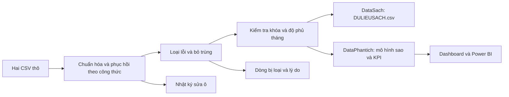

# Thiết kế hệ thống làm sạch và phân tích

Nguồn mô phỏng: bảng cửa hàng 02 và DULIEUTHO.csv, phạm vi 2023–2025. DataGoc chứa dữ liệu thô có lỗi được thêm có chủ đích; pipeline không chỉnh nguồn khi chạy.

## Dữ liệu sạch

Một tệp DULIEUSACH.csv, độ hạt cửa hàng–tháng. Nối thuộc tính bảng cửa hàng theo quan hệ nhiều–một. Nguồn dòng CSV được giữ để truy vết. Không dùng bảng sạch có sẵn làm nguồn để phục hồi lỗi: mọi suy ra dùng các thành phần cùng bản ghi thô.

## Làm sạch

Script/cleaning.py chuẩn hóa chữ, ngày, số, phần trăm và đơn vị; phục hồi số đơn/AOV nếu đủ hai thành phần còn lại; suy năm/quý từ tháng; tính lại cột dẫn xuất. Không nội suy hoặc lấy trung bình cho chi phí thiếu. Dòng không thể phục hồi bị loại, giữ nguyên nội dung gốc ở BaoCao/dong_bi_loai.csv.

Khóa trùng có cùng dữ liệu cơ sở sau chuẩn hóa được bỏ. Khóa mâu thuẫn phải xử lý nguồn trước khi xuất KPI. Thiếu cửa hàng–tháng sau loại lỗi cũng dừng xuất. Tháng mở cửa được tính là bắt đầu hoạt động, chưa có mô hình đóng cửa.

## Mô hình phân tích

| Bảng | Độ hạt | Mục đích |
|---|---|---|
| Dim_Store | store_id | Thuộc tính cửa hàng |
| Dim_Date | ngay | Lịch liên tục 2023–2025 |
| Fact_Operation | store_id + thang | Doanh thu, đơn, chi phí, lợi nhuận |
| Fact_Channel | store_id + thang + kenh | Doanh thu và đơn theo kênh |
| KPI_Thang / Quy / Nam | ky | Tổng hợp, tăng trưởng và cửa hàng bình quân |
| KPI_CuaHang_Nam | nam + store_id | So hiệu suất từng cửa hàng |

Dimension lọc một chiều tới fact. Không nối trực tiếp hai fact hoặc KPI tổng hợp vào fact. Các CSV trong DataPhantich là đầu ra phân tích, không phải nhiều bản dữ liệu sạch độc lập.

## KPI

## Mở rộng menu và vị trí (kịch bản giả định)

Nguồn 02 + DULIEUTHO chưa có POS theo món hoặc địa chỉ thực. `Script/menu_area.py` đọc `Script/gia_dinh_menu_khu_vuc.json`, tạo phân bổ có nhãn GIA_DINH_PHAN_BO_KHONG_PHAI_POS. Fact_Menu có khóa thang + store_id + kenh + menu_id; doanh thu phân bổ khớp Fact_Channel từng khóa cửa hàng–tháng–kênh trong dung sai 0,01 VND. Số lượng là ước tính theo giá tham chiếu, không thay thế số đơn hoặc số khách. Vị trí được gán cho cửa hàng hư cấu; không sửa doanh thu vận hành để tạo hiệu ứng vị trí.

Dim_Menu, Dim_Store, Dim_Date lọc một chiều tới Fact_Menu; không nối các fact trực tiếp. KPI khu vực tính từ fact vận hành gắn vị trí một–nhiều, không từ các dòng món lặp chi phí. Dashboard và `BaoCao/PhanTich_Menu_KhuVuc.md` phân biệt rõ giả thuyết với quan sát; không kết luận nhân quả hoặc sở thích thực tế. Word/slide hiện có thuộc phạm vi vận hành ban đầu.

### KPI vận hành

Doanh thu = tổng đơn × AOV từng kênh. LN vận hành = doanh thu − giá vốn − phí nền tảng − nhượng quyền − lương − thuê − khác − khấu hao. AOV, biên lợi nhuận và tỷ trọng online tính bằng tỷ số các tổng. Cửa hàng bình quân = cửa hàng–tháng / số tháng.

YoY so cùng kỳ năm trước; CAGR dùng tổng năm đủ 12 tháng và khoảng cách năm cuối−đầu. SSSG dùng cùng tập cửa hàng có đủ 12 tháng ở cả hai năm. Mẫu số 0 hoặc thiếu kỳ trước thì để trống. Không tính thị phần, biên ròng hoặc ROA/ROE vì thiếu nguồn tương ứng.
